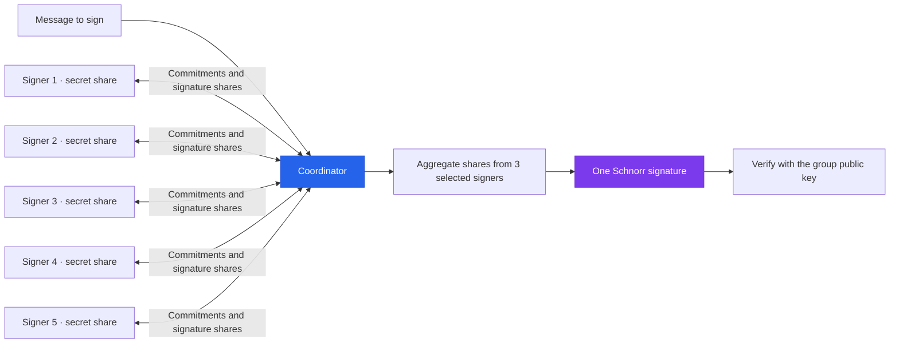

<div align="center">

# 3-of-5 FROST Signing Cluster

**Five independent signers. Three to sign. One verifiable signature.**

A distributed threshold-signing system built incrementally in Rust, using
**FROST — Flexible Round-Optimized Schnorr Threshold signatures**.


**[Architecture](#architecture) · [Protocol](#how-it-works) · [Nonce Safety](#nonce-safety) · [Roadmap](#roadmap) · [Acceptance Test](#acceptance-test)**

</div>

---

## The idea

Build a cluster of **five independent signer processes** where any **three** can
cooperate to sign a message. Each signer holds its own secret share. The signing
protocol produces a single Schnorr signature that can be verified against a
shared public key, without reconstructing the complete private key.

The project explores the full lifecycle: distributed key generation, two-round
signing, coordination, persistent state, and safe recovery when processes or
messages fail.

> **Current status:** This repository contains the project design and roadmap.
> Implementation, runnable commands, and automated tests are upcoming. The
> capabilities below describe the target system.

## At a glance

| Component | Target behavior |
| --- | --- |
| Signer cluster | Five independent processes, each holding one secret share |
| Signing threshold | Any three available, cooperating signers can sign |
| Key generation | Distributed key generation (DKG), with no trusted dealer |
| Signing protocol | Two-round FROST signing |
| Coordinator | Select participants, assemble signing packages, and aggregate shares |
| Verification | Verify the final Schnorr signature against the group public key |
| Persistence | Retain signer state and enforce one-time nonce use across restarts |
| Recovery | Handle failed signers, interrupted sessions, and coordinator restarts |
| Fault detection | Detect and reject invalid DKG and signature shares |

## Architecture



Each signing session selects three participants. The coordinator receives public
commitments and signature shares; the signers retain their secret key shares and
private nonces.

## How it works

### 1. Generate the key together

During **distributed key generation**, each signer contributes secret material
and participates in share exchange and verification. Successful DKG establishes:

- A private key share for each of the five signers.
- One common public key for verifying the cluster's signatures.
- Public verification material for checking signature shares.

No trusted dealer creates a master private key and splits it. The protocol is
designed so that no participant needs to assemble the complete key.

### 2. Commit to fresh signing nonces

For a signing attempt, the coordinator selects three signers. Each selected
signer generates fresh, one-time secret nonces and sends their **public
commitments** to the coordinator.

### 3. Produce signature shares

The coordinator assembles a signing package containing the message and the
selected participants' commitments. Each signer uses its secret key share,
private nonces, and the validated signing package to produce a **signature share**.

### 4. Aggregate and verify

The coordinator verifies the signature shares and combines valid shares into
one Schnorr signature. The final signature is checked against the group public
key.

```text
Secret key shares stay with their signers.

Signer 1 ── signature share ──┐
Signer 3 ── signature share ──┼──► Aggregate ──► Schnorr signature
Signer 5 ── signature share ──┘
```

## Security model

The central invariant is simple: **key generation and signing must never
reconstruct the complete private key**. Signers cooperate by producing signature
shares, rather than sending their secret key shares to the coordinator.

A 3-of-5 threshold also defines the trust boundary: fewer than three compromised
key shares should not enable signing, while three compromised signers reach the
threshold. Distributing shares does not remove the need to protect each signer.

Protocol and security documentation will specify the selected FROST ciphersuite,
DKG protocol, authenticated communication, signing authorization, and storage
protections as implementation progresses.

## Nonce safety

**Signing nonces are one-time secrets. Reuse can compromise signing keys.**

Each nonce set must follow a persistent lifecycle:

```text
GENERATED ──► COMMITTED ──► CONSUMED
                  │
                  └──────► RETIRED on an abandoned attempt

CONSUMED and RETIRED are terminal states.
```

Once a commitment is exposed, its secret nonces are permanently bound to that
signing attempt. An abandoned attempt must retire them; a new attempt must use
fresh nonces.

Crashes, duplicate requests, retries, and coordinator restarts must preserve this
invariant. Durable state transitions must prevent a restart from making an
already-used nonce available again.

## Built to handle failure

| Scenario | Required outcome |
| --- | --- |
| Signer unavailable before signing | Select another valid set of three participants |
| Signer fails during signing | Abandon the interrupted attempt safely and retry with fresh nonces |
| Fewer than three signers available | Refuse to produce a signature |
| Coordinator crashes or restarts | Recover session state safely without reusing nonces |
| Network message is missing | Detect the incomplete session and apply bounded timeout/retry behavior |
| Message is duplicated | Handle it without repeating a nonce-consuming operation |
| DKG share is invalid | Detect and reject it according to the DKG protocol |
| Signature share is invalid | Detect and reject it before accepting an aggregate signature |
| Session is stale | Reject messages that do not belong to the active signing attempt |
| Nonce reuse is attempted | Reject the operation and preserve the nonce's terminal state |

## Roadmap

Every milestone is intended to be small enough to understand, implement, test,
and review independently. All milestones are currently planned.

| Phase | Milestones |
| --- | --- |
| **Foundations** | `00` Initialize the Rust workspace<br>`01` Run independent signer processes<br>`02` Produce a single-signer Schnorr signature<br>`03` Demonstrate threshold sharing |
| **Distributed key generation** | `04` Implement DKG round 1<br>`05` Exchange DKG shares<br>`06` Verify DKG shares<br>`07` Complete DKG |
| **Threshold signing** | `08` Select 3-of-5 participants<br>`09` Generate signing nonces<br>`10` Exchange FROST round 1 commitments<br>`11` Produce FROST round 2 signature shares<br>`12` Aggregate the final signature |
| **Cluster coordination** | `13` Add the coordinator<br>`14` Introduce real network communication<br>`15` Implement reliable messaging |
| **State and recovery** | `16` Persist signer state<br>`17` Enforce nonce safety<br>`18` Handle signer failure<br>`19` Recover the coordinator |
| **Validation and documentation** | `20` Detect invalid shares<br>`21` Automate chaos and failure tests<br>`22` Document the protocol and security model |

## Development approach

```text
Learn one concept → Implement it → Test it → Commit → Build on it
```

Each commit should represent one understandable step toward the distributed
system. Early demonstrations establish the concepts; later milestones add the
coordination and recovery guarantees needed by the complete cluster.

Build, run, and test instructions will be added when the Rust workspace and
executable targets exist.

## Acceptance test

The completed implementation must demonstrate this sequence in automated tests:

1. Start five independent signer processes and complete DKG.
2. Select three signers, sign a message, and verify the final signature.
3. Kill one signer and sign successfully with another available set of three.
4. Kill and restart the coordinator, then recover safely.
5. Inject an invalid signature share and verify that it is detected and rejected.
6. Retry signing with fresh nonces and verify the resulting signature.
7. Check persisted nonce state and test instrumentation for nonce reuse across
   the entire sequence.

The test suite must also cover every three-signer combination, fewer than three
available signers, invalid DKG shares, stale sessions, missing and duplicated
messages, and explicit nonce-reuse attempts.

## Definition of done

- [ ] Working 3-of-5 distributed FROST signing across five independent processes
- [ ] Distributed key generation without a trusted dealer
- [ ] Coordinator with real network communication
- [ ] Persistent state and a crash-safe nonce lifecycle
- [ ] Signer failure handling and coordinator recovery
- [ ] Invalid-share detection and safe signing retries
- [ ] Automated functional and failure tests
- [ ] Protocol diagrams and documented security assumptions

---

<div align="center">

**Any three of five signers can sign. No single signer holds the complete key.**

</div>
